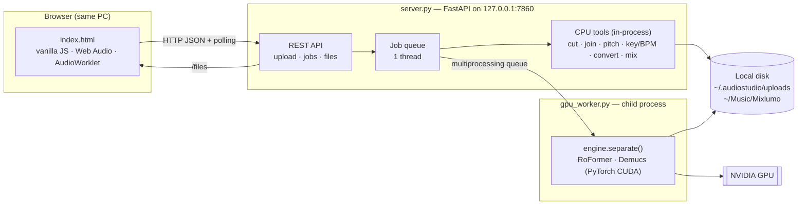
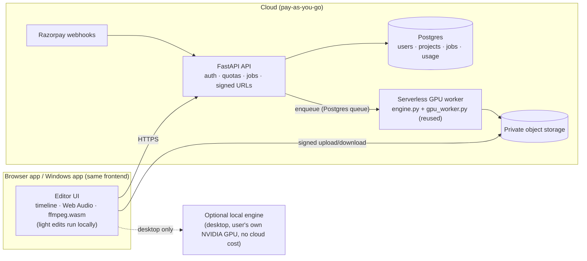

# Technical assessment — AI Music Editor (current codebase: "Mixlumo")

_Phases 1–2 of the master plan: inspection and gap analysis. Written 2026-11-23 from the
code on disk, the test suite and live runs, not from the brief's description. No code was
changed to produce this document._

---

## 0. Headline findings

1. **The brief's "existing decisions" are not implemented yet.** Browser + cloud GPU,
   freemium, accounts, payments and cloud storage do not exist in the code. What exists is a
   **local, single-user Windows web app**: a FastAPI server on `127.0.0.1` plus a one-file
   HTML UI, running AI models on the user's own NVIDIA GPU.
2. **What exists is solid and verified.** About 1,900 lines of application code and about
   1,600 lines of tests (171+ test cases, 99 % backend coverage). Objective audio-quality
   benchmarks pass on MUSDB18 reference stems. 15 defects were found by testing and fixed.
3. **The AI core is reusable as the future cloud GPU worker.** `engine.py` and
   `gpu_worker.py` are deliberately UI-independent, so they can run unchanged in a cloud GPU
   container. Reusing them is the cheapest path to "cloud GPU".
4. **Several brief items need decisions only you can make** (section 11): a frontend
   framework for the multi-track editor, the cloud providers, the desktop packaging
   approach, and moving the project out of the temporary session folder.
5. **Not reachable from this PC:** a GitHub account (no `gh` CLI, no Git repository yet), any
   cloud or payment account, and Rust (needed for Tauri). Node 24, Docker 28 and Git 2.39
   are installed.

---

## 1. Existing project assessment

### 1.1 Inventory

| Path | Lines | Role |
|---|---|---|
| `engine.py` | 442 | Audio and AI engine: decode/encode (ffmpeg), separation (BS-RoFormer, Mel-Band RoFormer, Demucs), pitch/tempo, key/BPM, cut, join, convert, mix; input validation; progress hooks |
| `gpu_worker.py` | 104 | Runs AI jobs in a child process (crash isolation, full GPU memory release) |
| `server.py` | 252 | FastAPI: upload, job queue (1 worker), job status/progress/ETA, file serving, idle GPU release |
| `static/index.html` | 801 | Single-page UI (vanilla JS/CSS): 6 tools, source preview with live speed/pitch, stem mixer, waveforms |
| `tests/` | ~1,600 | pytest unit/API/security/GPU/worker tests + Playwright e2e |
| `benchmarks/` | 283 | MUSDB18 objective quality benchmark (SDR, leakage, clipping, speed, GPU memory) |
| `run_tests.ps1` | 72 | Local CI gate: lint, types, unit, integration, e2e × 2 browsers, audit, build, GPU, coverage |
| `docs/`, `progress.md` | — | Testing strategy, test cases, benchmarks, defect log |
| `~/.audiostudio/venv` | 6.1 GB | Python 3.12 + PyTorch 2.5.1+cu118 (driver 457.34 supports only CUDA ≤ 11.x) |
| `~/.audiostudio/models` | 1.6 GB | Downloaded AI model weights |

Not present: Git repository, database, authentication, payments, cloud configuration,
Dockerfile, CI workflows, LICENSE/README, frontend build system, desktop packaging.

### 1.2 What works (verified by tests or live use)

| Area | Evidence |
|---|---|
| Upload of any ffmpeg-readable audio/video, 1 GB limit, spoofed files rejected | `test_api.py::TestUpload` |
| AI vocal removal / 2-, 4- and 6-stem separation | GPU tests + benchmark: BS-RoFormer vocals SDR 12.5 dB, Demucs 4-stem drums 7.1 dB / bass 11.1 dB |
| Live progress percentage, steps, ETA | `test_progress_is_real`, GPU browser journey |
| Stem mixer (synced playback, mute/solo/volume, export mix) | GPU e2e journey |
| Pitch & tempo (time-stretch or tape mode), live preview | engine + e2e tests |
| Key / BPM / Camelot | unit tests (A major ✓, 120 BPM ✓) |
| Cut with fades, join with crossfade, convert (wav/mp3/flac/ogg/m4a) | unit + e2e |
| Source preview player, Remove / Replace | e2e |
| GPU worker: crash recovery, idle release (5 min), full memory return | `test_worker.py`, `test_worker_process_returns_all_gpu_memory` |
| Accessibility basics, responsive 375–1440 px, Chromium + Edge | e2e |

### 1.3 Partially implemented

| Feature | What exists | What's missing |
|---|---|---|
| Processing queue | 1-worker in-memory queue | Persistence, cancellation, retries, timeouts, per-user fairness |
| Volume / fades / crossfade | Inside the cutter, joiner and mixer | General per-clip volume and fade editing on a timeline |
| Trim / merge | Cutter + joiner | Split at the playhead, timeline drag-and-drop |
| Video | Audio extracted from video uploads | All other creator tools |
| Themes | Dark theme with CSS variables | Light, system, custom accent, persistence |
| Export | 5 formats | Presets (YouTube, Reels, TikTok), loudness targets |
| Clipping | Prevented on output | Clipping *detection* report for user files |

### 1.4 Missing (brief section 4 and later)

Multi-track timeline, undo/redo, autosave, projects and history, loop, noise removal, voice
enhancement, silence removal, beat/downbeat, mastering, loudness normalisation (LUFS),
EQ/compression suggestions, ducking, SFX generation, natural-language assistant, video
sync and beat transitions, SFX/music library, keyboard shortcuts, zoom and snapping,
presets, batch processing, accounts, MFA, roles, payments, quotas, cloud storage, cloud
GPU, desktop installer, Git/GitHub, CI/CD, staging/production.

### 1.5 Broken or known defects (open)

| ID | Issue | Severity |
|---|---|---|
| D1 | PyTorch 2.5.1 is affected by **CVE-2025-32434** (`torch.load` code execution via a malicious checkpoint; fixed in 2.6). pip-audit cannot check CUDA builds. | Medium locally, **high in cloud** |
| D2 | Firefox e2e tests blocked (Visual C++ runtime missing on this PC) | Low |
| D3 | No job cancellation or timeout | Medium (high in cloud) |
| D7 | CPU tools (cut, pitch, …) run inside the web server process; a pathological file could stall the server | Medium |
| D8 | ffmpeg runs without CPU, memory or time limits | Medium locally, high in cloud |
| D9 | No HTTP security headers (CSP etc.) — acceptable on localhost only | Low now, required for cloud |

### 1.6 Performance (measured on this PC, GTX 1650 4 GB)

| Operation | Measured |
|---|---|
| BS-RoFormer *fast* (default), full song | ≈ 0.65 s per second of audio (≈ 3 min for a 4.5-min song) |
| BS-RoFormer *best* (overlap 8) | ≈ 2.4 s per s (≈ 11 min per song) for +0.06 dB |
| Demucs 4-stem | ≈ 0.25 s per s |
| Peak PyTorch memory | 0.55–1.24 GB (process total up to about 2.9 GB) |
| AI engine first start | about 5–10 s (worker spawn + model load) |

---

## 2. Current architecture

### Target architecture (proposal, needs approval)

---

## 3. Feature implementation status and priority

Score: **D** = user demand, **B** = business value, **C** = complexity, **$** = running cost
(1 = low, 3 = high). Priority P1 ships first.

| Feature | Status | D | B | C | $ | Priority |
|---|---|---|---|---|---|---|
| Vocal removal / stem separation | ✅ done | 3 | 3 | — | 3 (GPU) | **P1** (already built; move to cloud GPU) |
| Upload, waveform, playback, preview | ✅ done | 3 | 3 | — | 1 | P1 |
| Pitch / tempo, key / BPM | ✅ done | 3 | 2 | — | 1 | P1 |
| Trim / cut / merge / convert | ✅ done (single file) | 3 | 2 | — | 1 | P1 |
| Processing progress | ✅ done | 3 | 2 | — | — | P1 |
| **Cancellation, timeouts, retries** | ❌ | 2 | 3 | 1 | — | **P1** (required for any cloud use) |
| Loudness normalisation (LUFS) + clipping report | ❌ | 3 | 3 | 1 | 1 | **P1** |
| Export presets (YouTube / Reels / TikTok) | ❌ | 3 | 3 | 1 | 1 | **P1** |
| Themes: light / dark / system / accent | 🟡 dark only | 2 | 2 | 1 | — | **P1** |
| Accounts, quotas, freemium enforcement | ❌ | 3 | 3 | 3 | 1 | **P1** (before any public cloud launch) |
| Noise removal / voice enhancement | ❌ | 3 | 3 | 2 | 2 | P2 |
| Silence detection / removal | ❌ | 2 | 2 | 1 | 1 | P2 |
| Multi-track timeline, drag-and-drop, split, snapping, zoom | ❌ | 3 | 3 | 3 | 1 | P2 (largest UI build) |
| Undo/redo, autosave, projects, recent, history | ❌ | 3 | 2 | 2 | 1 | P2 (together with the timeline) |
| Beat / downbeat detection | 🟡 beats internal | 2 | 2 | 1 | 1 | P2 |
| Payments (Razorpay) + subscriptions | ❌ | — | 3 | 2 | fee | P2 (after quotas exist) |
| Windows installer | ❌ | 2 | 2 | 2 | — | P2 |
| Extract audio from video | ✅ basic | 3 | 2 | — | 1 | P1 (expose as a tool) |
| Sync to video / beat transitions / ducking / balancing | ❌ | 2 | 2 | 3 | 1 | P3 |
| Mastering, EQ/compression suggestions | ❌ | 2 | 2 | 2 | 1 | P3 |
| Natural-language assistant | ❌ | 2 | 2 | 2 | 2 (LLM) | P3 (rule-based parser first; LLM optional) |
| SFX / music library | ❌ | 2 | 2 | 1 | 1 | P3 (CC0 assets only) |
| Batch processing, presets, keyboard shortcuts | ❌ | 2 | 1 | 1 | — | P3 |
| Loop generation, AI SFX generation | ❌ | 1 | 2 | 3 | 3 | P4 (licensing and GPU cost) |

---

## 4. Security gap analysis

Today the app's main security control is that it **only listens on 127.0.0.1**, so no other
machine can reach it. A cloud service removes that protection, so most items below become
mandatory before any public deployment.

| Control (OWASP ASVS area) | Now | Gap for cloud |
|---|---|---|
| Authentication, MFA, sessions, password reset | N/A (no accounts) | Build or adopt (see §8; Supabase Auth gives Argon2/bcrypt hashing, email verification and MFA) |
| Authorization / IDOR | N/A | Per-user ownership checks on every upload, job and file; tests for cross-user access |
| Input validation | ✅ strict choices and ranges; raw paths rejected | Keep; add a schema (Pydantic models) for every endpoint |
| Upload: extension, MIME, real signature, size | ✅ size + content probe (ffmpeg decode); ⚠ no magic-byte allowlist | Add a signature allowlist, duration limit, per-plan limits |
| Path traversal | ✅ tested (names, static files, stem paths, folder opening) | Keep; storage keys must be server-generated UUIDs (already true for uploads) |
| Media-processing isolation | 🟡 AI runs in a child process; ffmpeg/CPU tools do not | Containerised workers, CPU/memory/time limits, **no outbound network**, non-root |
| Rate limiting, CORS, CSRF, security headers | ❌ (not needed on localhost) | Required: per-IP and per-user rate limits, CORS allowlist, CSP/HSTS, CSRF if cookie auth |
| Signed, expiring download URLs | ❌ (local `/files`) | Required with private object storage |
| Secrets | ✅ none in code | Secrets manager / platform env vars; Gitleaks in CI |
| Dependencies | ✅ pip-audit clean · ⚠ D1 torch CVE | Upgrade torch (needs CUDA ≥ 12 driver in cloud; fine on cloud GPUs) |
| Payments | N/A | Razorpay signature verification, idempotent webhooks, server-side entitlement |
| Static analysis | ✅ ruff incl. bandit `S` rules | Add Semgrep, Trivy (containers), Gitleaks, OWASP ZAP baseline against staging |
| Privacy | ✅ all processing local, nothing leaves the PC | Privacy policy, retention and deletion, no training on uploads without opt-in |

**Risk statement:** no system is 100 % secure. Remaining risks will be listed in a threat model
(`docs/threat-model.md`, phase 4) and re-assessed before each release.

---

## 5. Testing gap analysis

| Required by brief | Now | Gap |
|---|---|---|
| Unit / integration / API | ✅ 101 + 63 tests, 99 % backend coverage | Extend with each new feature |
| Frontend component tests (Vitest) | ❌ (no build system) | Comes with the frontend framework decision |
| End-to-end | ✅ 23 Playwright UI tests × Chromium + Edge, plus 1 GPU journey | Firefox blocked (D2); add the editor journeys |
| Audio quality | ✅ MUSDB18 SDR, leakage, clipping, length, sample rate | Add noise-removal metrics (e.g. SI-SDR on noisy speech sets), LUFS accuracy |
| GPU worker | ✅ real GPU tests, crash recovery, memory release | Cloud GPU smoke tests |
| Security tests | 🟡 traversal, spoofing, size, localhost binding | Auth, IDOR, CSRF, SSRF, rate limiting, webhook, ZAP |
| Performance | 🟡 benchmark + 50-request concurrency test | Locust against staging, large-file (1 GB / 2 h) tests, queue latency |
| Payments | ❌ | Razorpay test mode: success, failure, cancel, duplicate and invalid webhook, expiry |
| Desktop install / uninstall / update | ❌ | Clean-VM install tests (Windows Sandbox is free on Windows 11 Pro; this PC has Home, so use a VM or a GitHub Windows runner) |
| CI | 🟡 `run_tests.ps1` locally | GitHub Actions. Hosted runners have **no GPU**, so GPU stages need a self-hosted runner (this PC, free) or a cloud GPU smoke job |

---

## 6. Windows desktop packaging strategy

**Constraint that drives everything:** the AI engine is about 6 GB of Python/CUDA libraries plus
about 1.6 GB of models. An installer that bundles it would be about 3 GB or more, and would
only help users with NVIDIA GPUs.

| Option | Shell size | Pros | Cons |
|---|---|---|---|
| **Tauri 2** (recommended) | ~5–15 MB | Uses Windows' built-in WebView2; small; Rust-side updater and signing support; reuses the web frontend unchanged | Needs the Rust toolchain installed (free); WebView2 differences are small but real |
| Electron | ~150–250 MB | All JavaScript, mature ecosystem, Chromium everywhere | Large; higher memory use; more security hardening needed |
| PyWebView + PyInstaller | ~50 MB + engine | All Python | Weaker installer and updater tooling |

**Recommendation (needs approval):**
1. **Tauri shell** loading the same frontend as the browser app.
2. **Cloud mode by default**: AI jobs go to the cloud API, so the installer stays small.
3. **Optional "Local AI engine" download** inside the app for NVIDIA users: today's Python
   engine, frozen with PyInstaller and fetched on demand (~2.5–3 GB). It gives free,
   unlimited, private processing on the user's GPU, a selling point for a freemium
   product, and costs nothing in cloud GPU fees.
4. NSIS installer + portable ZIP; Tauri updater with signed update manifests.

**Code signing:** unsigned installers trigger Windows SmartScreen "unknown publisher" warnings.
A certificate is optional at first but costs money; it's listed in §9 and not assumed.

---

## 7. GitHub and CI/CD strategy

- **Repository layout** (proposal): `apps/web` (frontend), `apps/desktop` (Tauri),
  `services/api` (FastAPI), `services/worker` (engine + GPU worker), `packages/shared`
  (types), `tests/`, `benchmarks/`, `docs/`, `scripts/` (`setup.ps1`, `run-dev.ps1`,
  `test.ps1`, `build.ps1`, `build-windows.ps1`).
- **Branches:** `main` (release), `develop`, `feature/*`, `fix/*`. Protected `main`
  with required checks.
- **PR workflow** (GitHub-hosted, free tier): ruff, mypy, pytest (CPU), Vitest, Playwright,
  pip-audit, Semgrep, Gitleaks, build. Permissions: `contents: read`.
- **Release workflow:** on a version tag → build web, API image, Windows installer
  (`windows-latest` runner) → GitHub Release (draft, human-approved).
- **GPU tests:** self-hosted runner on this PC, triggered manually or nightly.
- **Cost:** public repo, Actions free. Private repo: 2,000 free minutes/month, and Windows
  runners consume them at 2× (to be verified against current GitHub pricing).
- **Blocked until you act:** create a GitHub account/repo and authenticate (`gh` CLI or a
  token). I will not push anything without your explicit approval.

---

## 8. Cloud deployment strategy (₹0–₹5,000/month)

Principle: **nothing always-on that costs money per hour.** Light edits run in the browser,
AI runs on serverless GPUs that bill per second only while a job runs, and everything else
fits free tiers at launch scale.

| Layer | Proposed | Why | Free tier (verify before signing up) |
|---|---|---|---|
| Frontend | Cloudflare Pages | Static hosting, global CDN | Free |
| API | Small container: Fly.io / Render / Oracle Cloud Always Free | FastAPI already exists | Oracle Always Free ARM VM is free; others ~$0–7/month |
| Database + queue | Postgres (Neon or Supabase) with a Postgres job table | Avoids paying for Redis | Free tiers ≈ 0.5 GB |
| Auth | Supabase Auth (or FastAPI + argon2-cffi) | Secure hashing, email verification, MFA without building them | Free up to tens of thousands of monthly users |
| Object storage | Cloudflare R2 (private, signed URLs) | **No egress fees**, which matters for audio downloads | 10 GB free |
| GPU | Serverless GPU (Modal / RunPod Serverless) running `engine.py` | Per-second billing, scales to zero | Modal includes a monthly free credit (verify) |
| Email | Resend / Brevo | Verification and reset mails | Free tiers ≈ 3,000/month |
| Payments | Razorpay | Your stated choice | No monthly fee; per-transaction fee |
| Monitoring | Sentry (free) + platform logs; UptimeRobot (free) | | Free tiers |

**Environments:** dev (this PC), staging (separate free-tier projects), production. No
deployment without your approval.

---

## 9. Budget and cost estimate

All prices are estimates from my knowledge and **must be verified** on the providers' pages
before signing up. ₹ figures assume about ₹85 per US$.

**GPU cost per song (main variable cost).** Measured: BS-RoFormer *fast* ≈ 0.65 s per second of
audio on a GTX 1650. A cloud T4/L4 is roughly 2–3× faster → about 60–100 s of GPU time for a
4-minute song, plus about 10–30 s cold start. At roughly $0.60/hour for a T4-class serverless
GPU → **≈ $0.02 (≈ ₹1.5–2) per song**.

| Item | Month 1–3 (launch, free tiers) | Realistic early production (~1,000 active users) |
|---|---|---|
| Frontend hosting | ₹0 | ₹0 |
| API hosting | ₹0 (Oracle free / free tier) | ₹0–600 |
| Database | ₹0 | ₹0–2,100 (paid tier if > 0.5 GB) |
| Storage + bandwidth (R2, auto-delete after 7 days) | ₹0 (< 10 GB) | ₹0–400 |
| GPU processing | ₹0–800 (free credit + ~500 songs) | ₹2,000–3,000 (≈ 1,500 songs at ₹1.5–2) |
| Natural-language assistant (LLM API) | ₹0 (rule-based parser) | ₹0–500 (small model, capped) |
| Email, monitoring, logs | ₹0 | ₹0 |
| Domain | ≈ ₹70–100/month (₹800–1,200/yr) | same |
| Code-signing certificate (optional) | ₹0 (unsigned) | ≈ ₹900/month for a cloud signing service, or ₹6,000–30,000/yr for a certificate |
| Razorpay fees | ~2 % per domestic transaction, ~3 % international | proportional to revenue |
| **Total** | **≈ ₹100–1,000** | **≈ ₹3,000–5,000+** (quotas must cap GPU spend) |

**What the budget cannot buy:** unlimited free AI separation. At about ₹1.5–2 per song,
₹3,000 of GPU covers roughly 1,500–2,000 songs per month across all free users. So free-tier
quotas (for example 3 AI separations per day, 10-minute limit) are a cost-control requirement,
not a marketing choice. The optional local engine for desktop users is the main lever that
grows usage without growing GPU cost.

---

## 10. Phased roadmap

Re-sequenced from the brief's 19 phases where dependencies require it (reasons given).

| Stage | Contents | Brief phases | Exit criteria |
|---|---|---|---|
| **0. Foundation** (next, after approval) | Move project to a permanent folder, `git init`, repo layout, README/LICENSE/SECURITY/.gitignore/.env.example, `setup.ps1`/`run-dev.ps1`/`test.ps1`, docs (architecture, threat model) | 3, 4, 15 (local part) | Clean repo, all existing tests green |
| **1. Frontend foundation** | Frontend framework + Vite build, design tokens, light/dark/system/accent themes, Vitest; port existing screens with no feature loss | 8 (moved earlier: every later UI feature depends on it) | Existing e2e suite passes on the new frontend |
| **2. Core editor** | Cancellation/timeouts, LUFS normalisation, clipping report, export presets, video audio extraction tool, then timeline: split, drag-and-drop, zoom, snapping, undo/redo, autosave, projects | 5, 7 (presets) | Feature tests + e2e journeys |
| **3. AI features** | Noise removal, voice enhancement, silence removal, beat/downbeat, mastering, ducking; rule-based NL assistant | 6 | Objective quality metrics per feature |
| **4. Accounts + cloud backend (staging)** | Postgres, auth, quotas, private storage, signed URLs, serverless GPU worker, security controls | 9, 11, 17 | Security test suite + ZAP baseline on staging |
| **5. Payments** | Razorpay test mode, subscriptions, webhooks | 9 | Payment test matrix |
| **6. Windows app** | Tauri shell, installer, portable, updater, optional local engine | 10, 14 | Clean-VM install/uninstall/update tests |
| **7. CI/CD + GitHub** | Actions (PR + release), branch protection, self-hosted GPU runner | 16 | Green pipeline on a PR |
| **8. Release** | Performance/security testing, acceptance, production deploy (with approval) | 12, 13, 18, 19 | Release acceptance report |

---

## 11. Decisions I need from you before major changes

1. **Project location.** The code currently lives in a temporary folder tied to this chat
   session; it must move to a permanent folder before Git or GitHub.
2. **Frontend framework** for the multi-track editor: React + TypeScript + Vite
   (recommended: largest ecosystem, matches the Vitest + React Testing Library policy) vs
   Svelte vs keeping vanilla JS (not recommended for a timeline editor).
3. **Desktop approach:** Tauri shell + cloud by default + optional local engine
   (recommended) vs Electron vs local-only.
4. **Cloud providers:** approve the §8 shortlist, or name providers you already use.
5. **Auth:** Supabase Auth (faster, hosted) vs self-built FastAPI auth (more control,
   more security work).
6. **Accounts I cannot create for you:** GitHub, cloud providers, Razorpay, domain. Each is
   free to open; I will tell you exactly what to create when its stage starts.
